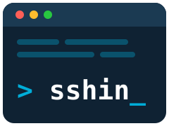

<p align="center">
    
</p>

# 🚀 SSHIN - SSH Manager

[](https://golang.org/)
[](https://github.com/chaad-grayson/sshin/releases)
[](LICENSE)
[](https://github.com/chaad-grayson/sshin/releases)

> **SSH manager yang modern dan interaktif, langsung dari terminal** 🔥

> [!NOTE]
> **SSHIN adalah fork dari [SSHM](https://github.com/Gu1llaum-3/sshm)** buatan [Guillaume Archambault](https://github.com/Gu1llaum-3), yang dirilis dengan Lisensi MIT. Semua kredit untuk proyek aslinya milik pembuat dan para kontributornya. Fork ini mengganti nama tool menjadi `sshin` dan menambahkan fitur-fitur baru di atasnya.

SSHIN adalah tool command-line untuk mengelola dan terhubung ke host SSH kamu. Dibuat dengan Go dan dilengkapi TUI (tampilan interaktif di terminal), SSHIN bikin urusan koneksi SSH jadi lebih cepat dan nyaman.

<p align="center">
    <a href="images/sshin.gif" target="_blank">
        
    </a>
    <br>
    <em>🖱️ Klik gambar untuk melihat ukuran penuh. Demo ini direkam dari SSHM, jadi perintah yang terlihat masih <code>sshm</code>.</em>
</p>

## ✨ Fitur

### 🚀 **Fitur Utama**
- **🎨 Tampilan TUI** - Jelajahi host SSH kamu lewat antarmuka terminal yang interaktif
- **⚡ Koneksi Cepat** - Langsung terhubung ke host mana pun lewat TUI atau CLI dengan `sshin <host>`
- **🔑 Simpan Password & 2FA** - Untuk server yang minta private key *dan* password atau kode verifikasi; password dan secret TOTP disimpan di keyring OS dan diisi otomatis
- **🔄 Port Forwarding** - Atur forwarding Local, Remote, dan Dynamic (SOCKS) dengan mudah, lengkap dengan riwayatnya
- **📝 Kelola dengan Mudah** - Tambah, edit, pindah, dan kelola konfigurasi SSH tanpa repot
- **🏷️ Tag** - Kelompokkan host dengan tag; tag khusus `hidden` menyembunyikan host dari daftar tapi host tetap bisa dikoneksikan
- **🔍 Pencarian** - Temukan host dengan cepat lewat filter dan pencarian
- **📝 Status Koneksi** - Indikator warna untuk status SSH tiap host, dicek di background saat TUI dibuka dan kapan pun diminta
- **🔔 Cek Update** - Pengecekan versi otomatis dengan notifikasi update
- **📈 Riwayat Koneksi** - Catat koneksi SSH kamu beserta waktu login terakhir

### 🛠️ **Fitur Teknis**
- **🔒 Aman** - Langsung bekerja dengan file `~/.ssh/config` yang sudah ada
- **📁 Config Kustom** - Pakai file konfigurasi SSH mana pun dengan flag `-c`
- **📂 Dukungan SSH Include** - Dukungan penuh untuk direktif `Include` agar konfigurasi bisa dipecah ke banyak file
- **⚙️ Opsi SSH** - Tambahkan opsi SSH apa pun lewat form
- **🔄 Konversi Otomatis** - Otomatis mengubah format command-line ke format config dan sebaliknya
- **🔄 Backup Otomatis** - Konfigurasi di-backup otomatis sebelum diubah
- **✅ Validasi** - Mencegah kesalahan konfigurasi dengan validasi bawaan
- **🔗 ProxyJump/ProxyCommand** - Tunneling koneksi lewat bastion host
- **⌨️ Shortcut Keyboard** - Navigasi cepat dengan shortcut ala vim
- **🌐 Lintas Platform** - Jalan di Linux, macOS (Intel & Apple Silicon), dan Windows
- **⚡ Ringan** - Satu binary tanpa dependency, tanpa perlu konfigurasi apa pun

## 🚀 Mulai Cepat

### Instalasi

**Unix/Linux/macOS (sekali jalan):**
```bash
curl -sSL https://raw.githubusercontent.com/chaad-grayson/sshin/main/install/unix.sh | bash
```

**Windows (PowerShell):**
```powershell
irm https://raw.githubusercontent.com/chaad-grayson/sshin/main/install/windows.ps1 | iex
```

**Cara lain (manual):**

*Linux/macOS:*
```bash
# Download rilis terbaru (ganti Linux_x86_64 sesuai sistem kamu, lihat tabel Rilis di bawah)
wget https://github.com/chaad-grayson/sshin/releases/latest/download/sshin_Linux_x86_64.tar.gz

# Ekstrak dan install
tar -xzf sshin_Linux_x86_64.tar.gz sshin
sudo mv sshin /usr/local/bin/sshin
```

*Windows:*
```powershell
# Download dan ekstrak
Invoke-WebRequest -Uri "https://github.com/chaad-grayson/sshin/releases/latest/download/sshin_Windows_x86_64.zip" -OutFile "sshin_Windows_x86_64.zip"
Expand-Archive sshin_Windows_x86_64.zip -DestinationPath C:\tools\
# Tambahkan C:\tools ke environment variable PATH
```

### Pindah dari SSHM

Nggak perlu melakukan apa-apa. Saat `sshin` pertama kali dijalankan, pengaturan, riwayat koneksi, riwayat port forwarding, dan backup SSHM kamu disalin dari `~/.config/sshm` (`%APPDATA%\sshm` di Windows) ke `~/.config/sshin`. Penyalinan ini cuma terjadi kalau `~/.config/sshin` belum ada, dan direktori SSHM tidak diubah sama sekali, jadi `sshm` tetap bisa dipakai. File `~/.ssh/config` dipakai bersama apa adanya: host dan tag yang ditulis SSHM langsung terbaca di SSHIN.

## 📖 Cara Pakai

### Mode Interaktif

Jalankan SSHIN tanpa argumen untuk membuka TUI:

```bash
sshin
```

**Pencarian (aktif saat TUI dibuka):**
- Ketik untuk memfilter host berdasarkan nama, hostname, atau tag
- `↑/↓` atau `Ctrl+P/Ctrl+N` - Pilih host tanpa keluar dari pencarian
- `Enter` - Konek ke host yang dipilih
- `Esc` - Kosongkan pencarian (keluar dari aplikasi kalau pencarian sudah kosong)
- `Tab` - Pindah ke tabel host, tempat shortcut di bawah berlaku

**Tabel host:**
- `↑/↓` atau `j/k` - Navigasi host
- `Enter` - Konek ke host yang dipilih
- `a` - Tambah host baru
- `e` - Edit host yang dipilih
- `d` - Hapus host yang dipilih
- `m` - Pindahkan host ke file config lain (butuh direktif SSH Include)
- `f` - Atur port forwarding
- `c` - Salin public key kamu ke host yang dipilih (`ssh-copy-id`)
- `t` - Pindah ke tab Tunnels (dan kembali)
- `p` - Cek ulang status semua host
- `H` - Tampilkan/sembunyikan host `hidden`
- `q` - Keluar
- `/` atau `Tab` - Kembali ke pencarian

**Indikator Status** (dicek saat TUI dibuka, dan lagi dengan `p`):
- 🟢 **Online** - Host bisa dijangkau lewat SSH
- 🟡 **Connecting** - Sedang mengecek koneksi ke host
- 🔴 **Offline** - Host tidak bisa dijangkau atau koneksi SSH gagal
- ⚫ **Unknown** - Status koneksi belum diketahui

**Urutan & Filter:**
- `s` - Ganti mode urutan (nama ↔ login terakhir)
- `n` - Urutkan berdasarkan **nama** (alfabet)
- `r` - Urutkan berdasarkan **terbaru** (waktu login terakhir)

Form interaktif akan memandu kamu mengisi konfigurasi:
- **Hostname/IP** - Alamat server
- **User** - User SSH
- **Port** - Port SSH (default: 22)
- **Identity File** - Lokasi private key
- **Password** - Opsional, untuk server yang juga minta password (disimpan di keyring OS)
- **ProxyJump** - Jump server untuk tunneling koneksi
- **ProxyCommand** - Perintah jump untuk tunneling koneksi
- **SSH Options** - Opsi SSH tambahan dalam format `-o` (contoh: `-o Compression=yes -o ServerAliveInterval=60`)
- **Tags** - Tag dipisahkan koma untuk mengelompokkan host

### Simpan Password (Key + Password)

Beberapa server minta password selain private key (misalnya dengan `AuthenticationMethods publickey,password`). Isi kolom **Password** saat menambah atau mengedit host, dan SSHIN akan mengetikkannya untuk kamu setiap kali konek.

- Password disimpan di keyring OS (Keychain di macOS, Secret Service seperti GNOME Keyring atau KWallet di Linux, Credential Manager di Windows), tidak pernah di `~/.ssh/config` atau file SSHIN mana pun.
- SSHIN hanya menjawab prompt password milik host itu (`user@hostname`), jadi host ProxyJump tidak akan pernah menerimanya. Prompt lain, seperti passphrase key atau konfirmasi host key baru, tetap ditanyakan di terminal kamu.
- Di form edit: biarkan kolom kosong untuk mempertahankan password yang tersimpan, ketik password baru untuk menggantinya, atau tekan `Ctrl+D` di kolom itu untuk menghapusnya. Menghapus host juga ikut menghapus password-nya.
- Kolom **Security** di tabel menunjukkan cara login tiap host: 🔑 private key dari `IdentityFile`, 🔑? tanpa `IdentityFile` (ssh otomatis mencoba key default `~/.ssh/id_rsa`, `id_ecdsa`, `id_ed25519`, dan key di ssh-agent; muncul kalau salah satunya ada), 🔒 password tersimpan, 📱 secret 2FA (TOTP) tersimpan. Penjelasan icon-nya juga ada di bawah tabel.
- Kalau server menolak password yang tersimpan, SSHIN nggak mengirimnya ulang: kamu diminta mengetik password di terminal, lalu perbaiki yang tersimpan lewat `e`.
- Mau pindah ke login pakai key saja? Tekan `c` di host itu: SSHIN menjalankan `ssh-copy-id` (password diisi otomatis) dan menyalin public key dari `IdentityFile` host itu, atau key default kalau host tidak punya `IdentityFile`. `ssh-copy-id` ikut terpasang bersama OpenSSH di Linux dan macOS, tapi tidak di Windows.
- Butuh OpenSSH 8.4 atau lebih baru (`SSH_ASKPASS_REQUIRE`) dan keyring yang aktif. Tanpa keyring, host tetap jalan seperti biasa dan `ssh` sendiri yang akan menanyakan password.

### 2FA (Verification Code)

Kalau server minta kode 2FA setelah login, misalnya `(user@host) Verification code:` dari Google Authenticator, isi kolom **2FA TOTP secret** di form tambah atau edit host. SSHIN lalu membuat kodenya sendiri tiap kali konek, persis seperti aplikasi authenticator.

- Secret-nya adalah kode base32 yang muncul saat 2FA dipasang (teks di bawah QR code, atau baris pertama `~/.google_authenticator` di server). Spasi dan huruf kecil boleh.
- Disimpan di keyring OS, sama seperti password, dan diatur dengan cara yang sama di form edit (kosongkan untuk mempertahankan, `Ctrl+D` untuk menghapus). Host dengan secret tersimpan ditandai 📱 di kolom Security.
- Yang didukung adalah TOTP standar: 6 digit, tiap 30 detik, SHA-1. Ini setelan bawaan Google Authenticator dan modul PAM-nya. Jam komputer kamu harus akurat.
- Kalau kodenya ditolak, SSHIN nggak mengirim ulang dan minta kamu mengetik kode di terminal.
- 2FA lewat push notification (Duo dan sejenisnya) atau SMS tidak bisa diisi otomatis.

### Tunnel

Tab **Tunnels** (tekan `t`) menyimpan tunnel yang bisa kamu nyalakan dan matikan, misalnya untuk database RDS yang cuma bisa diakses dari sebuah VM:

```
localhost:3307  →  VM (host SSH kamu)  →  mydb.xxxx.rds.amazonaws.com:3306
```

- `a` untuk menambah tunnel: isi nama, pilih host SSH yang sudah ada (←/→), port lokal, lalu host dan port tujuan yang bisa dijangkau dari host SSH itu.
- `Enter` atau `Spasi` untuk on/off, `e` edit, `d` hapus (tekan dua kali), `r` cek ulang status.
- Kolom **Last Active** menunjukkan `now` untuk tunnel yang sedang jalan, atau kapan terakhir tunnel itu dinyalakan atau dimatikan lewat SSHIN.
- Tunnel jalan di background dengan perintah yang sama seperti `ssh -f -N -o ServerAliveInterval=30 -o ServerAliveCountMax=3 -o ExitOnForwardFailure=yes -L 3307:ENDPOINT:3306 host`, jadi tetap hidup setelah SSHIN ditutup. Statusnya tetap terbaca saat SSHIN dibuka lagi.
- Linux dan macOS: tunnel tetap hidup setelah SSHIN atau terminalnya ditutup. Windows: OpenSSH di Windows tidak punya `-f` dan ControlMaster, jadi `ssh` jalan sebagai proses latar dari SSHIN (dilacak lewat `<nama>.pid`). Tunnel tetap hidup setelah SSHIN ditutup, tapi ikut berhenti kalau jendela terminalnya ditutup.
- Password dan kode 2FA yang tersimpan untuk host itu diisi otomatis. Prompt lain tetap ditanyakan di terminal sebelum tunnel pindah ke background.
- Kalau gagal (misalnya port lokal sudah dipakai), alasannya muncul di layar. Log lengkapnya ada di `~/.config/sshin/tunnels/<nama>.log` (Windows: `%APPDATA%\sshin\tunnels\`), dan daftar tunnel di `~/.config/sshin/tunnels.json`.
- Belum didukung di Windows, karena butuh ControlMaster OpenSSH.

Beda dengan `f` (Port Forwarding) di bawah: `f` membuka sesi forwarding sekali jalan di terminal, sedangkan tab Tunnels menyimpan tunnel yang bisa dinyalakan kapan saja.

### Port Forwarding

SSHIN menyediakan tampilan untuk mengatur port forwarding SSH. Tekan `f` saat sebuah host dipilih untuk membuka pengaturan port forwarding:

**Jenis Forwarding:**
- **Local (-L)** - Meneruskan port lokal ke host/port remote lewat koneksi SSH
  - Contoh: Mengakses database remote di `localhost:5432` lewat port lokal `15432`
  - Penggunaan: `ssh -L 15432:localhost:5432 server` → Database bisa diakses di `localhost:15432`

- **Remote (-R)** - Meneruskan port remote kembali ke host/port lokal
  - Contoh: Membuka web server lokal di port `8080` milik host remote
  - Penggunaan: `ssh -R 8080:localhost:3000 server` → Aplikasi lokal bisa diakses dari port 8080 di host remote
  - ⚠️ **Syarat agar bisa diakses dari luar:**
    - **Config SSH Server**: Tambahkan `GatewayPorts yes` ke `/etc/ssh/sshd_config` lalu restart service SSH
    - **Firewall**: Buka port remote di firewall server (`ufw allow 8080` atau yang setara)
    - **Ketersediaan Port**: Pastikan port remote belum dipakai
    - **Bind Address**: Pakai `0.0.0.0` untuk akses dari luar, `127.0.0.1` untuk akses lokal saja

- **Dynamic (-D)** - Membuat proxy SOCKS untuk browsing yang aman
  - Contoh: Melewatkan trafik web lewat koneksi SSH
  - Penggunaan: `ssh -D 1080 server` → Atur browser untuk memakai `localhost:1080` sebagai proxy SOCKS
  - ⚠️ **Yang perlu diatur:**
    - **Browser**: Atur proxy SOCKS v5 di pengaturan browser
    - **DNS**: Aktifkan "Proxy DNS when using SOCKS v5" untuk privasi penuh
    - **Aplikasi**: Hanya aplikasi yang mendukung SOCKS yang akan memakai proxy ini
    - **Bind Address**: Pakai `127.0.0.1` demi keamanan (akses lokal saja)

**Tampilan Port Forwarding:**
- Pilih jenis forwarding dengan tombol panah ←/→
- Atur port dan alamat lewat form yang memandu
- Bind address opsional (default: 127.0.0.1)
- Validasi nomor port dan alamat secara langsung
- **Riwayat port forwarding** - Konfigurasi yang sering dipakai tersimpan untuk dipakai lagi
- Langsung konek dengan opsi forwarding yang sudah diatur

**Troubleshooting Port Forwarding:**

*Masalah Remote Forwarding:*
```bash
# Error: "remote port forwarding failed for listen port X"
# Solusi:
1. Cek apakah port sudah dipakai: ssh server "netstat -tln | grep :X"
2. Pakai port lain yang masih kosong
3. Aktifkan GatewayPorts di config SSH untuk akses dari luar
```

*Konfigurasi SSH Server untuk Remote Forwarding:*
```bash
# Edit config SSH daemon di server:
sudo nano /etc/ssh/sshd_config

# Tambahkan atau aktifkan:
GatewayPorts yes

# Restart service SSH:
sudo systemctl restart sshd  # Ubuntu/Debian/CentOS 7+
# ATAU
sudo service ssh restart     # Sistem lama
```

*Konfigurasi Firewall:*
```bash
# Ubuntu/Debian (UFW):
sudo ufw allow [nomor_port]

# CentOS/RHEL/Rocky (firewalld):
sudo firewall-cmd --add-port=[nomor_port]/tcp --permanent
sudo firewall-cmd --reload

# Cek apakah port bisa diakses:
telnet [ip_server] [nomor_port]
```

*Pengaturan Browser untuk Dynamic Forwarding (SOCKS):*
```
Firefox: about:preferences → Network Settings
- Manual proxy configuration
- SOCKS Host: localhost, Port: [port_kamu]
- SOCKS v5: ✓
- Proxy DNS when using SOCKS v5: ✓

Chrome: Jalankan dengan proxy
chrome --proxy-server="socks5://localhost:[port_kamu]"
```

### Penggunaan CLI

SSHIN bisa dipakai lewat perintah command-line maupun TUI interaktif:

```bash
# Buka TUI untuk menjelajahi dan konek ke host
sshin

# Konek langsung ke host tertentu (tercatat di riwayat)
sshin my-server

# Jalankan perintah di host remote
sshin my-server uptime

# Jalankan perintah dengan argumen
sshin my-server ls -la /var/log

# Paksa alokasi TTY untuk perintah interaktif
sshin -t my-server sudo systemctl restart nginx

# Buka TUI dengan file config SSH kustom
sshin -c /path/to/custom/ssh_config

# Konek langsung dengan file config SSH kustom
sshin my-server -c /path/to/custom/ssh_config

# Tambah host baru lewat form interaktif
sshin add

# Tambah host baru dengan hostname yang sudah terisi
sshin add hostname

# Tambah host baru ke file config SSH kustom
sshin add hostname -c /path/to/custom/ssh_config

# Edit konfigurasi host yang sudah ada
sshin edit my-server

# Edit host di file config SSH kustom
sshin edit my-server -c /path/to/custom/ssh_config

# Pindahkan host ke file config SSH lain (butuh direktif Include)
sshin move my-server

# Pindahkan host di file config SSH kustom (butuh direktif Include)
sshin move my-server -c /path/to/custom/ssh_config

# Cari host (filter interaktif)
sshin search

# Tampilkan info host dalam format JSON untuk scripting
sshin info prod-server
sshin info prod-server --pretty

# Dengan file config SSH kustom
sshin -c /path/to/custom/ssh_config info prod-server

# Teruskan ke jq
sshin info prod-server | jq -r '.result.target.hostname'
sshin info prod-server | jq -r '.result.target.user'

# Tampilkan versi
sshin --version

# Matikan pengecekan update (berguna di mesin tanpa internet)
sshin --no-update-check

# Tampilkan bantuan dan daftar perintah
sshin --help
```

### Info Host (JSON)

`sshin info <hostname>` mencetak satu objek JSON ke stdout supaya bisa diolah di script dengan `jq`.

```bash
# Ambil field tertentu
sshin info prod-server | jq -r '.result.target.hostname'
sshin info prod-server | jq -r '.result.target.port'

# Cek host yang tidak ditemukan (exit code 2)
sshin info does-not-exist | jq -r '.error.code'
```

### Shell Completion

SSHIN mendukung shell completion untuk nama host, jadi kamu bisa konek tanpa mengetik nama lengkapnya:

```bash
sshin <TAB>           # Tampilkan semua host
sshin pro<TAB>        # Lengkapi host yang diawali "pro" (misalnya prod-server)
```

**Cara Mengaktifkan:**

**Bash:**
```bash
# Aktifkan untuk sesi ini
source <(sshin completion bash)

# Aktifkan permanen (tambahkan ke ~/.bashrc)
echo 'source <(sshin completion bash)' >> ~/.bashrc
```

**Zsh:**
```bash
# Aktifkan untuk sesi ini
source <(sshin completion zsh)

# Aktifkan permanen (tambahkan ke ~/.zshrc)
echo 'source <(sshin completion zsh)' >> ~/.zshrc
```

**Fish:**
```bash
# Aktifkan untuk sesi ini
sshin completion fish | source

# Aktifkan permanen
sshin completion fish > ~/.config/fish/completions/sshin.fish
```

**PowerShell:**
```powershell
# Aktifkan untuk sesi ini
sshin completion powershell | Out-String | Invoke-Expression

# Aktifkan permanen (tambahkan ke profil PowerShell)
Add-Content $PROFILE 'sshin completion powershell | Out-String | Invoke-Expression'
```

### Koneksi Langsung ke Host

SSHIN bisa langsung konek ke host dari command line, jadi gampang dipakai di alur kerja yang sudah ada:

```bash
# Konek langsung ke host mana pun yang sudah dikonfigurasi
sshin production-server
sshin db-staging
sshin web-01

# Semua koneksi langsung tercatat di riwayat
# Buka TUI untuk melihat host yang terakhir kamu koneksikan
```

**Keunggulan Koneksi Langsung:**
- **Langsung konek** - Tanpa perlu navigasi di TUI
- **Tercatat di riwayat** - Semua koneksi dicatat beserta waktunya
- **Pesan error yang jelas** - Kalau host tidak ada atau konfigurasinya bermasalah
- **Dukungan file config** - Bisa dipakai dengan file config kustom lewat flag `-c`

### Menjalankan Perintah di Remote

Jalankan perintah di host remote tanpa membuka shell interaktif:

```bash
# Jalankan satu perintah
sshin prod-server uptime

# Jalankan perintah dengan argumen
sshin prod-server ls -la /var/log

# Cek pemakaian disk
sshin prod-server df -h

# Lihat log (teruskan ke perintah lokal)
sshin prod-server 'cat /var/log/nginx/access.log' | grep 404

# Paksa alokasi TTY untuk perintah interaktif (sudo, vim, dll.)
sshin -t prod-server sudo systemctl restart nginx
```

**Keunggulan:**
- **Exit code diteruskan** - Exit code dari perintah remote ikut dikembalikan
- **Dukungan TTY** - Pakai flag `-t` untuk perintah yang butuh interaksi terminal
- **Bisa di-pipe** - Output bisa diteruskan ke perintah lokal
- **Tercatat di riwayat** - Eksekusi perintah dicatat di riwayat koneksi

### Backup Konfigurasi

SSHIN otomatis membuat backup file konfigurasi SSH sebelum melakukan perubahan apa pun, supaya konfigurasi kamu tetap aman.

**Lokasi Backup:**
- **Unix/Linux/macOS**: `~/.config/sshin/backups/` (atau `$XDG_CONFIG_HOME/sshin/backups/` kalau di-set)
- **Windows**: `%APPDATA%\sshin\backups\` (cadangan: `%USERPROFILE%\.config\sshin\backups\`)

**Fitur Utama:**
- Backup otomatis sebelum setiap perubahan
- Satu backup per file (backup sebelumnya ditimpa)
- Disimpan terpisah supaya tidak bentrok dengan SSH Include
- Mudah dipulihkan secara manual kalau perlu

**Data Lain yang Disimpan:**
- **Riwayat Koneksi**: Disimpan di direktori config yang sama
- **Riwayat Port Forwarding**: Konfigurasi forwarding yang sering dipakai, untuk dipakai lagi dengan cepat

**Pemulihan Cepat:**
```bash
# Unix/Linux/macOS
cp ~/.config/sshin/backups/config.backup ~/.ssh/config

# Windows
copy "%APPDATA%\sshin\backups\config.backup" "%USERPROFILE%\.ssh\config"
```

### Opsi File Konfigurasi

Secara default, SSHIN memakai file konfigurasi SSH standar di `~/.ssh/config`. Kamu bisa memakai file konfigurasi lain dengan flag `-c`:

```bash
# Pakai file config kustom di mode TUI
sshin -c /path/to/custom/ssh_config

# Pakai file config kustom dengan perintah lain
sshin add hostname -c /path/to/custom/ssh_config
sshin edit hostname -c /path/to/custom/ssh_config
sshin move hostname -c /path/to/custom/ssh_config
```

### Fitur Lanjutan

#### Memindahkan Host Antar File Config

SSHIN punya perintah `move` untuk memindahkan host SSH antar file konfigurasi. **Fitur ini butuh direktif SSH Include di konfigurasi SSH kamu.**

```bash
# Pindahkan host ke file config lain (butuh direktif Include)
sshin move my-server

# Pindahkan dengan file config kustom (butuh direktif Include)
sshin move my-server -c /path/to/custom/ssh_config
```

**⚠️ Syarat Penting:**
- **Direktif SSH Include harus ada** di file config SSH kamu (`~/.ssh/config` atau file yang ditentukan dengan `-c`)
- File config harus berisi baris `Include` yang merujuk ke file konfigurasi SSH lain
- Tanpa direktif Include, perintah move akan menampilkan pesan error

**Keunggulan:**
- **Pemilih file interaktif** - Pilih file config tujuan dari daftar direktif Include
- **Dukungan Include** - Bekerja mulus dengan struktur direktif SSH Include
- **Operasi atomik** - Pemindahan host yang aman dengan backup otomatis
- **Validasi** - Mencegah konflik dan menjaga konfigurasi tetap utuh
- **Penanganan error** - Pesan yang jelas kalau file Include dibutuhkan tapi tidak ditemukan

**Contoh Penggunaan:**
- Merapikan host dari config utama ke file include khusus
- Memindahkan host development ke config terpisah per environment
- Menggabungkan konfigurasi supaya lebih teratur

**Contoh Setup yang Dibutuhkan:**
File config SSH utama kamu harus berisi direktif Include seperti ini:
```ssh
# ~/.ssh/config
Include ~/.ssh/config.d/*
Include work-servers.conf
Include projects/*.conf

Host personal-server
    HostName personal.example.com
    User myuser
```

#### Status Koneksi

SSHIN mengecek koneksi SSH secara asinkron dan menampilkan indikator ketersediaan host:

**Indikator Status:**
- 🟢 **Online** - Koneksi SSH berhasil (menampilkan waktu respons)
- 🟡 **Connecting** - Sedang mengetes koneksi
- 🔴 **Offline** - Koneksi SSH gagal atau host tidak bisa dijangkau
- ⚫ **Unknown** - Status belum diketahui

**Keunggulan:**
- **Tidak memblokir** - Status diperbarui di background
- **Waktu respons** - Lihat latensi koneksi untuk host yang online
- **Dicek saat dibuka** - Semua host yang terlihat dicek saat TUI dibuka; tekan `p` untuk cek ulang. Set `ping_on_start` ke `false` kalau mau cek hanya saat diminta
- **Detail error** - Informasi error yang lengkap untuk koneksi yang gagal

#### Cek Update Otomatis

SSHIN punya pengecekan versi bawaan yang memberi tahu kalau ada update:

**Keunggulan:**
- **Di background** - Pengecekan versi berjalan asinkron, tidak pernah menghambat saat aplikasi dibuka
- **Notifikasi rilis** - Tanda yang jelas kalau ada update
- **Deteksi pre-release** - Mengenali versi beta dan development
- **Integrasi GitHub** - Link langsung ke halaman rilis
- **Tidak mengganggu** - Update tidak menginterupsi pekerjaan kamu
- **Bisa diatur** - Bisa dimatikan untuk lingkungan offline atau tanpa internet

**Notifikasi update muncul:**
- Di TUI utama sebagai notifikasi kecil, lengkap dengan perintah update untuk OS kamu
- Hanya kalau ada versi stabil yang lebih baru

**Cara update** (jalankan ulang installer, versi lama langsung ditimpa):

Linux/macOS:
```bash
curl -sSL https://raw.githubusercontent.com/chaad-grayson/sshin/main/install/unix.sh | bash
```

Windows (PowerShell, jawab `y` saat ditanya):
```powershell
irm https://raw.githubusercontent.com/chaad-grayson/sshin/main/install/windows.ps1 | iex
```

**Mematikan pengecekan update:**

Lewat flag CLI (sekali jalan):
```bash
sshin --no-update-check
```

Lewat `~/.config/sshin/config.json` (permanen):
```json
{
  "check_for_updates": false
}
```

#### Riwayat Port Forwarding

SSHIN mengingat konfigurasi port forwarding kamu supaya mudah dipakai lagi:

**Keunggulan:**
- **Tersimpan otomatis** - Setup forwarding yang berhasil disimpan otomatis
- **Pakai ulang dengan cepat** - Konfigurasi sebelumnya muncul sebagai saran
- **Riwayat per host** - Riwayat forwarding dicatat untuk tiap host SSH
- **Semua jenis forwarding** - Mendukung riwayat Local (-L), Remote (-R), dan Dynamic (-D)
- **Tersimpan permanen** - Riwayat tetap ada walau aplikasi ditutup

### Catatan per Platform

**Windows:**
- SSHIN bekerja dengan client OpenSSH bawaan (Windows 10/11)
- Lokasi file konfigurasi: `%USERPROFILE%\.ssh\config`
- Kompatibel dengan konfigurasi SSH di WSL
- Mendukung opsi SSH yang sama dengan sistem Unix

**Unix/Linux/macOS:**
- File konfigurasi SSH standar: `~/.ssh/config`
- Kompatibel penuh dengan fitur OpenSSH
- Permission file dijaga secara otomatis

## 🏗️ Konfigurasi

SSHIN bekerja langsung dengan file konfigurasi SSH standar kamu (`~/.ssh/config`). SSHIN menambahkan komentar khusus (seperti `# Tags:`) untuk fitur tambahan, tanpa merusak kompatibilitas dengan tool SSH standar.

### Dukungan SSH Include

SSHIN mendukung penuh direktif SSH Include, jadi konfigurasi SSH bisa dipecah ke banyak file. Ini sangat membantu kalau host kamu banyak, atau kalau ingin mengelompokkan konfigurasi per environment, proyek, atau tim.

**Contoh Include:**
```ssh
# File utama ~/.ssh/config
Host personal-server
    HostName personal.example.com
    User myuser

# Sertakan konfigurasi kantor
Include work-servers.conf

# Sertakan semua konfigurasi dari satu direktori
Include projects/*

# Include dengan path relatif ke home
Include ~/.ssh/configs/production.conf
```

**Contoh Pengelompokan:**

*work-servers.conf:*
```ssh
# Tags: work, production
Host prod-web-01
    HostName 10.0.1.10
    User deploy
    ProxyJump bastion.company.com

# Tags: work, staging
Host staging-api
    HostName staging-api.company.com
    User developer
```

*projects/client-alpha.conf:*
```ssh
# Tags: client, development
Host client-alpha-dev
    HostName dev.client-alpha.com
    User admin
    Port 2222
```

**Contoh konfigurasi:**
```ssh
Include ~/.ssh/conf.d/*

# Tags: production, web, frontend
Host web-prod-01
    HostName 192.168.1.10
    User deploy
    Port 22
    IdentityFile ~/.ssh/production_key
    Compression yes
    ServerAliveInterval 60

# Tags: development, database
Host db-dev
    HostName dev-db.company.com
    User admin
    Port 2222
    IdentityFile ~/.ssh/dev_key
    StrictHostKeyChecking no
    UserKnownHostsFile /dev/null

# Tags: production, backend
Host backend-prod
    HostName 10.0.1.50
    User app
    Port 22
    ProxyJump bastion.company.com
    ProxyCommand ssh -W %h:%p Jumphost
    IdentityFile ~/.ssh/production_key
    Compression yes
    ServerAliveInterval 300
    BatchMode yes
```

### Opsi SSH yang Didukung

SSHIN mendukung semua opsi konfigurasi SSH standar:

**Kolom Bawaan:**
- `HostName` - Hostname atau alamat IP server
- `User` - Username untuk koneksi SSH
- `Port` - Nomor port SSH
- `IdentityFile` - Lokasi file private key
- `ProxyJump` - Jump server untuk tunneling koneksi (contoh: `user@jumphost:port`)
- `ProxyCommand` - Perintah jump untuk tunneling koneksi (contoh: `ssh -W %h:%p Jumphost`)
- `Tags` - Tag kustom (ekstensi SSHIN); tag khusus `hidden` menyembunyikan host dari TUI dan `sshin search`, tapi host tetap bisa dikoneksikan lewat `sshin <host>`

Password tidak termasuk di sini karena tidak ditulis ke config SSH; lihat [Simpan Password](#simpan-password-key--password).

**Opsi SSH Tambahan:**
Kamu bisa menambahkan opsi SSH apa pun lewat kolom "SSH Options" di form interaktif. Tulis dalam format command-line (contoh: `-o Compression=yes -o ServerAliveInterval=60`) dan SSHIN akan otomatis mengubahnya ke format config SSH yang benar.

**Opsi SSH yang Sering Dipakai:**
- `Compression` - Aktifkan/matikan kompresi (`yes`/`no`)
- `ServerAliveInterval` - Interval (detik) pengiriman pesan keepalive
- `ServerAliveCountMax` - Jumlah maksimum pesan keepalive
- `StrictHostKeyChecking` - Verifikasi host key (`yes`/`no`/`ask`)
- `UserKnownHostsFile` - Lokasi file known hosts
- `BatchMode` - Matikan prompt interaktif (`yes`/`no`)
- `ConnectTimeout` - Batas waktu koneksi (detik)
- `ControlMaster` - Multiplexing koneksi (`yes`/`no`/`auto`)
- `ControlPath` - Lokasi socket kontrol
- `ControlPersist` - Lama koneksi dibiarkan tetap hidup
- `ForwardAgent` - Teruskan SSH agent (`yes`/`no`)
- `LocalForward` - Port forwarding lokal (contoh: `8080:localhost:80`)
- `RemoteForward` - Port forwarding remote
- `DynamicForward` - Port forwarding proxy SOCKS

**Contoh pengisian di form:**
```
SSH Options: -o Compression=yes -o ServerAliveInterval=60 -o StrictHostKeyChecking=no
```

Akan otomatis diubah menjadi:
```ssh
    Compression yes
    ServerAliveInterval 60
    StrictHostKeyChecking no
```

### Konfigurasi Aplikasi

SSHIN punya file konfigurasi untuk mengatur perilakunya, termasuk key binding dan pengecekan update.

**Lokasi File Konfigurasi:**
- **Linux/macOS**: `~/.config/sshin/config.json`
- **Windows**: `%APPDATA%\sshin\config.json`

**Contoh Konfigurasi:**
```json
{
  "check_for_updates": false,
  "focus_search_on_start": false,
  "ping_on_start": false,
  "key_bindings": {
    "quit_keys": ["q", "ctrl+c"],
    "disable_esc_quit": true
  }
}
```

**Opsi yang Tersedia:**
- **check_for_updates**: Boolean untuk mengaktifkan atau mematikan pengecekan update saat aplikasi dibuka. Default: `true`. Set ke `false` di mesin offline atau tanpa internet supaya tidak ada jeda koneksi.
- **focus_search_on_start**: Boolean untuk menentukan fokus saat TUI dibuka. Default: `true` (kolom pencarian). Set ke `false` untuk mulai di tabel host; flag `-s` / `--search` tetap membuka di kolom pencarian.
- **ping_on_start**: Boolean untuk mengecek status semua host yang terlihat saat TUI dibuka. Default: `true`. Set ke `false` untuk cek hanya saat kamu menekan `p` (misalnya kalau host-nya banyak, atau ada host di balik ProxyJump yang lambat).
- **quit_keys**: Array tombol untuk keluar dari aplikasi. Default: `["q", "ctrl+c"]`
- **disable_esc_quit**: Boolean untuk mencegah tombol ESC menutup aplikasi. Default: `false`

**Untuk Pengguna Vim:**
Kalau kamu sering tidak sengaja menekan ESC sampai aplikasinya tertutup, set `disable_esc_quit` ke `true`. ESC tidak lagi menutup aplikasi, sementara fungsi lainnya tetap jalan.

**Untuk Mesin Tanpa Internet:**
Kalau SSHIN lambat dibuka karena timeout DNS saat menghubungi GitHub, set `check_for_updates` ke `false`. Kamu juga bisa memakai flag `--no-update-check` untuk sekali jalan tanpa mengubah file config.

**Konfigurasi Default:**
Kalau file konfigurasi belum ada, SSHIN otomatis membuatnya dengan pengaturan default.

## 🛠️ Pengembangan

### Prasyarat

- Go 1.27+
- Git

### Build dari Source

```bash
# Clone repository
git clone https://github.com/chaad-grayson/sshin.git
cd sshin

# Build binary (dengan versi dari git)
make build-local

# Jalankan
./dist/sshin

# Jalankan test
make test
```

Test dijalankan dengan direktori home sementara, jadi tidak pernah menyentuh `~/.ssh` atau `~/.config/sshin` milikmu.

### Struktur Proyek

```
sshin/
├── main.go               # Entry point aplikasi
├── cmd/                  # Perintah CLI (Cobra)
│   ├── root.go           # Perintah utama, mode interaktif, dan koneksi langsung
│   ├── add.go            # Perintah tambah host
│   ├── edit.go           # Perintah edit host
│   ├── move.go           # Perintah pindah host
│   ├── search.go         # Perintah cari host
│   ├── info.go           # Perintah info host (JSON)
│   └── completion.go     # Shell completion
├── internal/
│   ├── config/           # Manajemen konfigurasi
│   │   ├── ssh.go        # Parsing dan pengubahan config SSH
│   │   ├── appconfig.go  # config.json milik SSHIN
│   │   └── migrate.go    # Impor pengaturan dari SSHM
│   ├── connectivity/     # Pengecekan koneksi SSH
│   │   └── ping.go       # Ping SSH asinkron
│   ├── history/          # Riwayat koneksi dan port forwarding
│   │   └── history.go
│   ├── secret/           # Password host di keyring OS
│   │   ├── secret.go     # Simpan, ambil, hapus password
│   │   └── askpass.go    # Mengisi prompt password ssh (SSH_ASKPASS)
│   ├── testhome/         # Direktori home sementara untuk test
│   ├── ui/               # Komponen TUI (Bubble Tea)
│   │   ├── tui.go        # Setup program TUI
│   │   ├── model.go      # Model dan state TUI
│   │   ├── update.go     # Penanganan pesan dan perubahan state
│   │   ├── view.go       # Rendering tampilan
│   │   ├── table.go      # Tabel host dengan indikator status
│   │   ├── add_form.go   # Form tambah host
│   │   ├── edit_form.go  # Form edit host
│   │   ├── move_form.go  # Form pindah host
│   │   ├── info_form.go  # Tampilan info host
│   │   ├── port_forward_form.go # Pengaturan port forwarding dengan riwayat
│   │   ├── styles.go     # Definisi style Lip Gloss
│   │   └── sort.go       # Logika urutan dan filter
│   ├── validation/       # Validasi input
│   │   └── ssh.go
│   └── version/          # Pengecekan versi dan update
│       └── version.go
├── images/               # Aset dokumentasi
│   ├── logo.svg          # Logo proyek
│   └── sshin.gif         # Animasi demo
├── install/              # Script instalasi
│   ├── unix.sh           # Installer Unix/Linux/macOS
│   ├── windows.ps1       # Installer Windows
│   └── README.md         # Panduan instalasi
├── .github/workflows/
│   ├── ci.yml            # gofmt, vet, dan test di Linux, macOS, Windows
│   └── release.yml       # Rilis dengan GoReleaser saat tag di-push
├── .goreleaser.yaml      # Konfigurasi build rilis
├── Makefile
├── go.mod
├── LICENSE               # Lisensi MIT
└── README.md             # Dokumentasi proyek
```

### Dependency

- [Cobra](https://github.com/spf13/cobra) - Framework CLI
- [Bubble Tea](https://github.com/charmbracelet/bubbletea) - Framework TUI
- [Bubbles](https://github.com/charmbracelet/bubbles) - Komponen TUI
- [Lipgloss](https://github.com/charmbracelet/lipgloss) - Styling
- [go-keyring](https://github.com/zalando/go-keyring) - Akses keyring OS untuk password
- [Go Crypto](https://pkg.go.dev/golang.org/x/crypto) dan [x/term](https://pkg.go.dev/golang.org/x/term) - Utilitas SSH dan terminal

## 📦 Rilis

Rilis dibuat otomatis untuk beberapa platform:

| Platform | Arsitektur | Download |
|----------|------------|----------|
| Linux | AMD64 | [sshin_Linux_x86_64.tar.gz](https://github.com/chaad-grayson/sshin/releases/latest/download/sshin_Linux_x86_64.tar.gz) |
| Linux | ARM64 | [sshin_Linux_arm64.tar.gz](https://github.com/chaad-grayson/sshin/releases/latest/download/sshin_Linux_arm64.tar.gz) |
| Linux | ARMv7 | [sshin_Linux_armv7.tar.gz](https://github.com/chaad-grayson/sshin/releases/latest/download/sshin_Linux_armv7.tar.gz) |
| Linux | i386 | [sshin_Linux_i386.tar.gz](https://github.com/chaad-grayson/sshin/releases/latest/download/sshin_Linux_i386.tar.gz) |
| macOS | Intel | [sshin_Darwin_x86_64.tar.gz](https://github.com/chaad-grayson/sshin/releases/latest/download/sshin_Darwin_x86_64.tar.gz) |
| macOS | Apple Silicon | [sshin_Darwin_arm64.tar.gz](https://github.com/chaad-grayson/sshin/releases/latest/download/sshin_Darwin_arm64.tar.gz) |
| Windows | AMD64 | [sshin_Windows_x86_64.zip](https://github.com/chaad-grayson/sshin/releases/latest/download/sshin_Windows_x86_64.zip) |
| Windows | i386 | [sshin_Windows_i386.zip](https://github.com/chaad-grayson/sshin/releases/latest/download/sshin_Windows_i386.zip) |

Setiap rilis juga menyertakan `checksums.txt` (SHA-256) untuk memverifikasi file yang kamu download.

## 🤝 Kontribusi

Kontribusi sangat diterima! Silakan kirim Pull Request. Untuk perubahan besar, buka issue dulu untuk mendiskusikan apa yang ingin kamu ubah.

### Alur Kerja Pengembangan

1. **Fork** repository ini
2. **Buat** branch fitur (`git checkout -b feature/fitur-keren`)
3. **Commit** perubahan kamu (`git commit -m 'feat: tambah fitur keren'`)
4. **Push** ke branch tersebut (`git push origin feature/fitur-keren`)
5. **Buka** Pull Request

## 📝 Lisensi

Proyek ini dilisensikan di bawah Lisensi MIT. Lihat file [LICENSE](LICENSE) untuk detailnya.

SSHIN diturunkan dari [SSHM](https://github.com/Gu1llaum-3/sshm), Copyright (c) 2025 Guillaume Archambault, yang juga berlisensi MIT. Pemberitahuan hak cipta dan izin aslinya tetap disimpan di [LICENSE](LICENSE) sesuai syarat lisensi.

## 🙏 Terima Kasih

- [Guillaume Archambault](https://github.com/Gu1llaum-3) yang membuat [SSHM](https://github.com/Gu1llaum-3/sshm), proyek asal fork SSHIN
- [Charm](https://charm.sh/) untuk library TUI-nya yang luar biasa
- [Cobra](https://cobra.dev/) untuk framework CLI-nya
- [@yimeng](https://github.com/yimeng) yang menyumbangkan dukungan direktif SSH Include
- [@ldreux](https://github.com/ldreux) yang menyumbangkan pencarian multi-kata
- [@qingfengzxr](https://github.com/qingfengzxr) yang menyumbangkan dukungan key binding kustom
- Komunitas Go yang membangun tool-tool hebat

---

<div align="center">

**SSHIN dikelola oleh [chaad-grayson](https://github.com/chaad-grayson), berdasarkan [SSHGO](https://github.com/chandra-bachtiar/sshgo) oleh [chandra-bachtiar](https://github.com/chandra-bachtiar) dan [SSHM](https://github.com/Gu1llaum-3/sshm) yang dibuat dengan ❤️ oleh [Guillaume](https://github.com/Gu1llaum-3)**

⭐ **Kasih bintang repo ini kalau menurutmu bermanfaat!** ⭐

</div>
